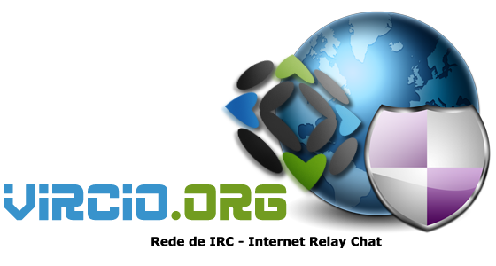
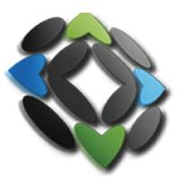

# vIRCio — Identidade Visual

**Rede social de batepapo - Conectando pessoas.**

Este é o repositório público da **identidade visual da Rede vIRCio**.

Aqui vamos preservar a história da marca, organizar seus elementos gráficos e compartilhar a evolução do visual da nossa rede social de bate-papo e comunidades.

A proposta é construir uma identidade reconhecível no site, no webchat, nas comunidades, nas redes sociais e nos demais pontos de contato da vIRCio.

## O que vamos reunir

- **Marca oficial:** logotipos, símbolos, favicon, cores e orientações de uso.
- **História:** versões anteriores da identidade visual, com datas e créditos quando confirmados.
- **Artes e modelos:** peças para redes sociais, divulgação e materiais da comunidade.
- **Propostas:** estudos, experimentações e sugestões ainda não aprovadas.

> **Em construção:** esta coleção preserva materiais históricos, sem homologação de autoria, licenças ou qualidade para produção. Nenhum arquivo histórico ou proposta representa automaticamente a identidade oficial atual da marca.

## Acervo histórico — Diego e Rafael

Este acervo reúne as logos identificadas nos dois sites legados, suas variantes,
símbolos, avatar social, capas com aplicação da marca, imagens de compartilhamento,
favicon relacionado à marca e QR code associado ao domínio vIRCio.net.

**São 32 arquivos, com 20 conteúdos binários distintos.** As cópias compartilhadas
foram mantidas em cada origem para mostrar onde os materiais eram usados; nomes
iguais em coleções diferentes não significam que sejam a mesma imagem.

Os arquivos foram copiados sem conversão, redimensionamento, recompressão ou
alteração de metadados. Cada cópia foi comparada por SHA-256 com a fonte completa
local e com o snapshot histórico publicado correspondente. Os arquivos históricos
de origem não foram modificados. Esta verificação cobre os 32 assets selecionados,
não a integridade de todas as árvores dos sites.

### Prévia das principais variantes

| Origem | Prévia | Descrição |
| --- | --- | --- |
| Diego — site |  | Símbolo em verde-lima e wordmark cinza; há também versão branca. |
| Rafael — portal clássico, também presente no lightIRC de Diego |  | Globo/escudo com wordmark vIRCio.org. |
| Rafael — rodapé clássico |  | Wordmark horizontal azul/verde, sem o globo/escudo. |
| Rafael — avatar clássico |  | Variante gráfica geométrica usada no arquivo social; não é uma simples redução da logo principal. |
| Rafael — v2 |  | Balão verde com cruz branca e wordmark vircio.net. |

Algumas imagens têm transparência ou texto branco. Sua leitura muda conforme o
fundo claro/escuro do GitHub; o arquivo original não foi adaptado para este README.

### Diego — marca do site

Diretório: [`legacy/diego/site/`](legacy/diego/site/).

| Arquivo | Aplicação |
| --- | --- |
| [logo-branco.png](legacy/diego/site/logo-branco.png) | Variante com wordmark branco; usada no cabeçalho e painel do site legado. |
| [logo-cinza.png](legacy/diego/site/logo-cinza.png) | Variante com wordmark cinza; usada na página de contato. |
| [vircio-icone.png](legacy/diego/site/vircio-icone.png) | Símbolo isolado da marca. |

### Materiais clássicos compartilhados entre os sites

Cada um dos seis arquivos abaixo existe nos três diretórios:

- [`legacy/diego/lightirc/`](legacy/diego/lightirc/)
- [`legacy/rafael/portal/`](legacy/rafael/portal/)
- [`legacy/rafael/lightirc/`](legacy/rafael/lightirc/)

As três cópias de cada arquivo são idênticas em bytes. Isso prova a duplicação,
mas não estabelece autoria nem qual cópia foi criada primeiro.

| Arquivo — link para a cópia do portal Rafael | Aplicação |
| --- | --- |
| [logo.png](legacy/rafael/portal/logo.png) | Logo principal clássica vIRCio.org. |
| [logo-rodape.png](legacy/rafael/portal/logo-rodape.png) | Wordmark horizontal para rodapé. |
| [logo-facebook.jpg](legacy/rafael/portal/logo-facebook.jpg) | Avatar social geométrico. |
| [capa.png](legacy/rafael/portal/capa.png) | Capa com wordmark vIRCio.org sobre fotografia. |
| [capa2.png](legacy/rafael/portal/capa2.png) | Outra composição fotográfica com aplicação do wordmark. |
| [qrcode-vircio-net.png](legacy/rafael/portal/qrcode-vircio-net.png) | Material auxiliar associado ao domínio pelo nome do arquivo; destino do QR não foi decodificado/revalidado nesta publicação. |

O portal Rafael também possui dois arquivos próprios desta seleção:

- [og-img.png](legacy/rafael/portal/og-img.png): imagem de compartilhamento com balões azul e verde.
- [favicon.ico](legacy/rafael/portal/favicon.ico): favicon legado, preservado no formato ICO.

### Rafael — versão v2

Diretório: [`legacy/rafael/v2/`](legacy/rafael/v2/).

| Arquivo | Aplicação |
| --- | --- |
| [logo.png](legacy/rafael/v2/logo.png) | Composição vertical do balão com cruz e wordmark vircio.net. |
| [logo3.png](legacy/rafael/v2/logo3.png) | Variante vertical mais compacta. |
| [editar a logo.png](legacy/rafael/v2/editar%20a%20logo.png) | Variante PNG preservada com seu nome histórico. |
| [editar a logo facebook.png](legacy/rafael/v2/editar%20a%20logo%20facebook.png) | Aplicação quadrada com wordmark dentro do balão. |
| [green-balloon-chat-plus-add.png](legacy/rafael/v2/green-balloon-chat-plus-add.png) | Símbolo do balão/cruz sem o wordmark inferior. |
| [og-img.png](legacy/rafael/v2/og-img.png) | Símbolo quadrado para compartilhamento. |
| [capa.png](legacy/rafael/v2/capa.png) | Capa com aplicação da marca. |
| [capa-facebook.png](legacy/rafael/v2/capa-facebook.png) | Variante da capa social. |
| [editar a capa.png](legacy/rafael/v2/editar%20a%20capa.png) | Outra composição PNG da capa, com wordmark dentro do símbolo. |

Os nomes “editar a ...” não comprovam a existência de arquivos vetoriais ou
projetos editáveis em camadas: os materiais encontrados são imagens PNG. Não
foram localizadas fontes SVG, PSD, AI, EPS ou XCF para estas logos na busca dos
materiais legados; não foram produzidas novas versões ou vetorização.

### Procedência e organização

| Diretório neste repositório | Caminho na fonte histórica |
| --- | --- |
| `legacy/diego/site/` | Diego: `vircio/vircio-site/web/site/img/` |
| `legacy/diego/lightirc/` | Diego: `vircio/lightIRC/imagens/` |
| `legacy/rafael/portal/` | Rafael: `public_html/imagens/`, exceto `favicon.ico`, que veio de `public_html/favicon.ico` |
| `legacy/rafael/lightirc/` | Rafael: `public_html/lightIRC/imagens/` |
| `legacy/rafael/v2/` | Rafael: `public_html/v2/imagens/` |

Referências públicas usadas na comparação:

- [Snapshot Diego](https://github.com/vIRCio/vIRCio-site/tree/99ff2aff6e6981e667d6511bd5d239e3b64b403a), branch `site-diego`.
- [Snapshot Rafael](https://github.com/vIRCio/vIRCio-site/tree/6c7d7212780d14452be5fbcb1b2a5058f22889c2), branch `site-rafael`.

Os nomes Diego/Rafael identificam as origens dos sites, não uma atribuição
comprovada de autoria individual de cada desenho. As datas de criação das logos
não foram confirmadas e não foram inferidas a partir de metadados.

Os hashes das cópias estão em [`legacy/SHA256SUMS`](legacy/SHA256SUMS). Para
conferir os arquivos a partir da raiz deste repositório:

```sh
sha256sum --check legacy/SHA256SUMS
```

### Exclusões e limites

- O `logo.png` do site Diego com a inscrição **HEADER 3** é um placeholder de template e não foi incluído.
- O `favicon.png` e o `apple-touch-icon.png` do site Diego mostram o **B do Bootstrap**, não a marca vIRCio, e não foram incluídos.
- Ícones de xadrez, bibliotecas, emoticons, screenshots, fundos genéricos, imagens de comunidades/terceiros e código dos sites ficaram fora da seleção.
- O Site 2025/Aurora Dark e os previews Social Minimalism não fazem parte desta importação.
- As capas incluem fotografias ou fundos de terceiros cuja licença, autoria e autorizações de imagem não foram homologadas. A preservação histórica não concede permissão de reutilização.
- A inspeção foi estática e seletiva. Metadados, direitos e conteúdo binário não receberam auditoria profunda; não há garantia absoluta de ausência de dados ocultos.

### Relação com a marca atual

Este acervo é **histórico**, não uma escolha da nova identidade. A apresentação
atual é **vIRCio — Conectando pessoas**, uma rede social de bate-papo e comunidades.
Logo, paleta, favicon, tipografia e aplicações da marca do novo site ainda passarão
pela definição e aprovação próprias de UX/branding.

## Participe

A identidade visual também pode evoluir com a comunidade!

Você pode abrir uma [issue](https://github.com/vIRCio/vIRCio-brand/issues) para sugerir melhorias, enviar um *pull request* ou participar das Discussions, quando estiverem habilitadas.

Toda contribuição será avaliada antes de integrar o material oficial.

## Uso da marca e direitos

A publicação neste repositório não concede automaticamente licença de reutilização ou uso comercial dos elementos visuais. As condições de uso serão documentadas separadamente.

## Projetos relacionados

- **Site:** [vircio.net](https://vircio.net)
- **Identidade visual:** este repositório público
- **Código do site:** privado, com futura integração dos materiais aprovados

---

**vIRCio — Conectando pessoas.**
